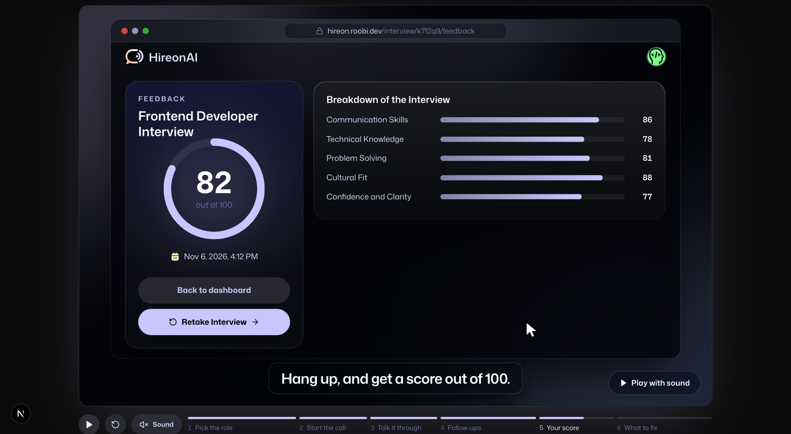

# HireonAI

Practice job interviews out loud. Tell HireonAI the role you want, and an AI interviewer asks you questions written for that role and your tech stack, by voice, in your browser. When you hang up, you get a score out of 100 with what to fix before the real interview.

**Live:** https://hireon.roobi.dev



## Features

- **Questions for your exact role.** Pick the job title, level (Junior, Mid-level, Senior), focus (Technical, Behavioural, Mixed), tech stack and number of questions. Gemini writes the questions.
- **A real voice conversation.** The interviewer reads each question aloud and listens to your answer, with live captions. It runs on the browser's own speech APIs, so it's free.
- **Follow-up questions.** After a vague answer, the interviewer asks one short follow-up, like a real interviewer would.
- **A scored report.** Your transcript is scored from 0 to 100 in five areas: Communication Skills, Technical Knowledge, Problem Solving, Cultural Fit, and Confidence and Clarity. You also get your strengths and areas to improve.
- **Retake any interview.** Past interviews stay on your dashboard, and each retake gets a fresh score.
- **Sign in with email or Google.**

Voice works in Chrome, Edge and Safari. Firefox doesn't support browser speech recognition.

## Tech stack

- [Next.js 15](https://nextjs.org) (App Router) and React 19
- [Better Auth](https://www.better-auth.com) for email/password and Google sign-in
- [Neon](https://neon.tech) Postgres with [Drizzle ORM](https://orm.drizzle.team)
- [Gemini](https://ai.google.dev) through the [AI SDK](https://ai-sdk.dev), with a model fallback chain for the free tier
- Browser `speechSynthesis` and `SpeechRecognition` for voice ([Vapi](https://vapi.ai) is an optional paid engine)
- Tailwind CSS v4, shadcn/ui and Motion
- Deployed on [Vercel](https://vercel.com)

## Run it locally

You need Node.js 20 or later, a Neon database, and a Gemini API key.

```bash
git clone https://github.com/roobiwebdev/Hireon.git
cd Hireon
npm install
```

Create `.env.local` in the project root:

```bash
DATABASE_URL=                      # Neon Postgres connection string
BETTER_AUTH_SECRET=                # any long random string
BETTER_AUTH_URL=http://localhost:3000
GOOGLE_GENERATIVE_AI_API_KEY=      # Gemini API key

# Optional: "Continue with Google" appears only when both are set
GOOGLE_CLIENT_ID=
GOOGLE_CLIENT_SECRET=

# Optional: use Vapi instead of free browser voice (needs Vapi credits)
NEXT_PUBLIC_VOICE_PROVIDER=vapi
NEXT_PUBLIC_VAPI_WEB_TOKEN=
NEXT_PUBLIC_VAPI_WORKFLOW_ID=
```

For Google sign-in, add `http://localhost:3000/api/auth/callback/google` as an authorized redirect URI in your Google Cloud OAuth client.

Create the tables, then start the app:

```bash
npm run db:migrate
npm run dev
```

Open http://localhost:3000.

## Scripts

| Command | What it does |
| --- | --- |
| `npm run dev` | Start the dev server with Turbopack |
| `npm run build` | Production build |
| `npm run lint` | ESLint |
| `npx tsc --noEmit` | Type-check (the build skips type errors, so run this) |
| `npm run db:generate` | Create a SQL migration from `db/schema.ts` |
| `npm run db:migrate` | Apply migrations to `DATABASE_URL` |
| `npm run db:studio` | Browse the database |

## How it works

1. **Setup.** The form at `/interview` calls a server action that asks Gemini for questions and saves the interview.
2. **The call.** The interviewer speaks each question, listens until you pause, and decides whether to ask a follow-up.
3. **Scoring.** When the call ends, Gemini scores the transcript against a fixed schema, and the report opens at `/interview/[id]/feedback`.

Every server action checks the signed-in user first, and all input and AI output is validated with zod.

```
app/(marketing)/   landing page at /
app/(auth)/        sign-in and sign-up
app/(root)/        dashboard and interview pages (signed in only)
components/        UI, including the call screen and the landing page's product film
lib/actions/       server actions for data and AI
lib/ai/            Gemini models and the question prompt
lib/voice/         browser speech and call errors
db/                Drizzle schema and migrations
```

Contributor and agent rules live in [CLAUDE.md](CLAUDE.md).
